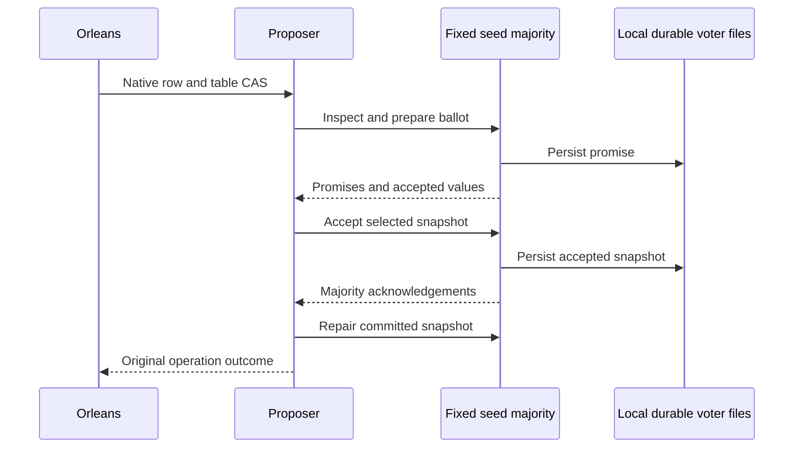

# ADR 0001: Durable membership inside fixed seed silos

Status: Accepted design; initial delivery qualification in progress.

## Context

The owner requested a ManagedCode fork of Reuben Bond's RapidCluster that replaces Azure membership for Orleans 10.4, discovers configured IP peers, survives dynamic silo churn and exposes a real native membership table. RAPID provides discovery, observation and agreement on a participant view. Orleans membership additionally requires atomic row/version compare-and-swap and durable coordination across restarts.

## Decision

Use RAPID for advisory observation of the fixed configured seed voters. Ordinary silos register through native Orleans membership and do not enlarge that RAPID group. Implement `IMembershipTable` and `IGatewayListProvider` over a durable majority Paxos register inside the same seed processes. Any caller may propose; there is no permanently designated table leader. Native Orleans still owns runtime membership transitions, probes, directory, placement and grains.

Use the native generated Orleans serializer with explicit stable IDs and aliases for peer/durable contracts, carried in bounded protobuf envelopes. Admit peers only after identity/configuration/secret validation. Persist checksummed voter state with an exclusive directory lock and flushed atomic replacement. Preserve bounded durable mutation outcomes across internal retries; report an explicitly indeterminate result when its outcome has aged out.

Native RAPID hosted lifecycle starts after the membership listener binds. The durable table can operate once its fixed quorum is available, independently of stale advisory observations. This allows one returning voter to restore a lost majority without waiting for every former RAPID participant.

## Consequences

Three seeds tolerate one unavailable voter; five tolerate two. Fifty silos do not require fifty table voters. Large ordinary-silo losses remain recoverable if the fixed voter majority survives. Loss of a majority deliberately prevents successful table operations. Changing seed order/membership online is unsupported; wiping voter state while peers can still run violates the persistence contract. A shared secret supplies admission, not encryption.

Local process restarts and abrupt kills are qualified separately from arbitrary power loss. Application grain state is outside this provider. No external database, independent application cluster runtime, dynamic quorum shrink or consumer-side workaround is introduced.

## Implementation and qualification

The provider, durable quorum, native hosting and original upstream repair batch are implemented in this checkout. Focused consensus/native tests and real three-silo Aspire qualification have local evidence. Complete fifty-process churn, original simulation inventory, platform CI, NuGet publication and KeyLoad adoption are separate remaining acceptance gates; their original reports determine completion. See [requirements](../Features/RapidMembership.md) and the [work item](../../tasks/in-progress/001_OrleansRapidMembership.md).
