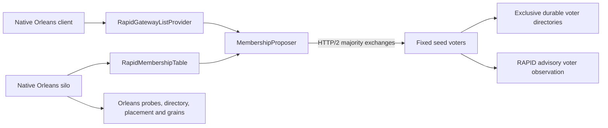
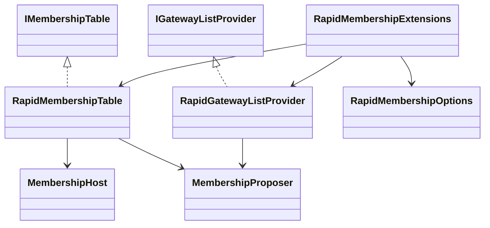
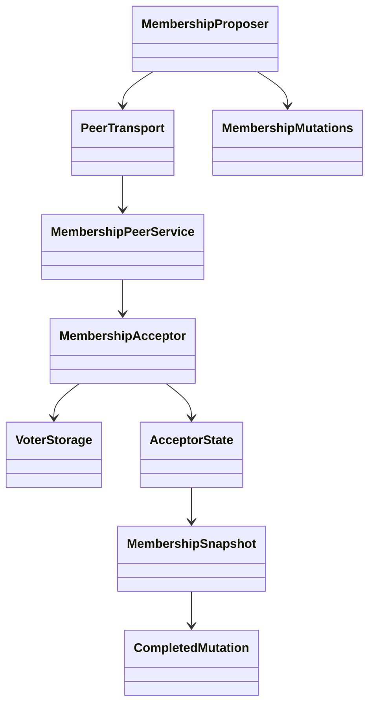

# Architecture

[README](../README.md) owns installation and deployment configuration. [Rapid membership requirements](Features/RapidMembership.md) owns the observable contracts. [ADR 0001](ADR/0001-self-hosted-membership.md) records why the table needs durable majority consensus in addition to RAPID observation.

## Modules

The [provider](../src/ManagedCode.Orleans.RapidMembership/) owns native table and gateway adapters. [RapidCluster.Core](../src/RapidCluster.Core/) owns the upstream RAPID protocol; [RapidCluster.Grpc](../src/RapidCluster.Grpc/) owns its transport. The separate membership-table gRPC service is owned by the provider. Application state, grain scheduling and native silo failure detection remain Orleans responsibilities.

## Public interfaces and boundaries

[RapidMembershipExtensions](../src/ManagedCode.Orleans.RapidMembership/RapidMembershipExtensions.cs) registers either silo membership or client gateway discovery. [RapidMembershipOptions](../src/ManagedCode.Orleans.RapidMembership/RapidMembershipOptions.cs) validates explicit literal-IP endpoints, shared identity, secret and resource bounds. [RapidMembershipTable](../src/ManagedCode.Orleans.RapidMembership/RapidMembershipTable.cs) translates the native Orleans membership contract into atomic mutations; [RapidGatewayListProvider](../src/ManagedCode.Orleans.RapidMembership/Operations/RapidGatewayListProvider.cs) returns active native gateway rows.

Only configured voters start a [MembershipHost](../src/ManagedCode.Orleans.RapidMembership/Hosting/MembershipHost.cs). Its private HTTP/2 listener hosts the table acceptor and RAPID transport with shared admission limits. Native RAPID hosted lifecycle owns observation startup and joined shutdown. Ordinary silo processes do not join RAPID or hold an acceptor. A table operation depends on the configured durable quorum, not on an advisory RAPID view.

## Consensus and storage

[MembershipProposer](../src/ManagedCode.Orleans.RapidMembership/Consensus/MembershipProposer.cs) coordinates bounded quorum operations and recovers accepted proposals. [MembershipAcceptor](../src/ManagedCode.Orleans.RapidMembership/Consensus/MembershipAcceptor.cs) preserves promises and accepted/committed values; [VoterStorage](../src/ManagedCode.Orleans.RapidMembership/Storage/VoterStorage.cs) holds an exclusive process lock, verifies the cluster/configuration identity and checksum, and flushes an atomic replacement before acknowledging state changes. [PeerContracts](../src/ManagedCode.Orleans.RapidMembership/Consensus/PeerContracts.cs) owns explicit native generated serializer contracts. [MembershipMutations](../src/ManagedCode.Orleans.RapidMembership/Operations/MembershipMutations.cs) owns row/version CAS, heartbeat and cleanup semantics.

Reads inspect a majority. Pending accepted proposals enter recovery before returning; a committed snapshot is repaired to a majority. Reads without pending work do not allocate another Paxos log slot. Writes retain bounded durable operation outcomes so concurrent internal retries preserve acknowledged results. An unresolved outcome older than the retained floor reports ambiguity explicitly. No operation can safely succeed without the configured majority.

## Qualification ownership

[AppHost](../tests/ManagedCode.Orleans.RapidMembership.AppHost/Program.cs) declares actual native silo projects and commands; [Node](../tests/ManagedCode.Orleans.RapidMembership.Node/Program.cs) composes Orleans and exposes test observations. [Provider tests](../tests/ManagedCode.Orleans.RapidMembership.Tests/) own real HTTP/2 consensus, native client calls, abrupt faults, exact membership observations and joined cleanup. Four external clients continue calls while the scale scenario changes the live process set. The retained upstream simulation suite qualifies RAPID under deterministic faults; it does not prove actual Orleans process behavior.

The [CI workflow](../.github/workflows/ci.yml) keeps platform, scale, upstream and package gates distinct. [Release](../.github/workflows/release.yml) independently builds and pushes one three-package batch to NuGet, without waiting for CI or polling feed indexing. Original artifacts identify the scope and result of each run. Local process restart tests do not establish arbitrary filesystem power-loss durability.
